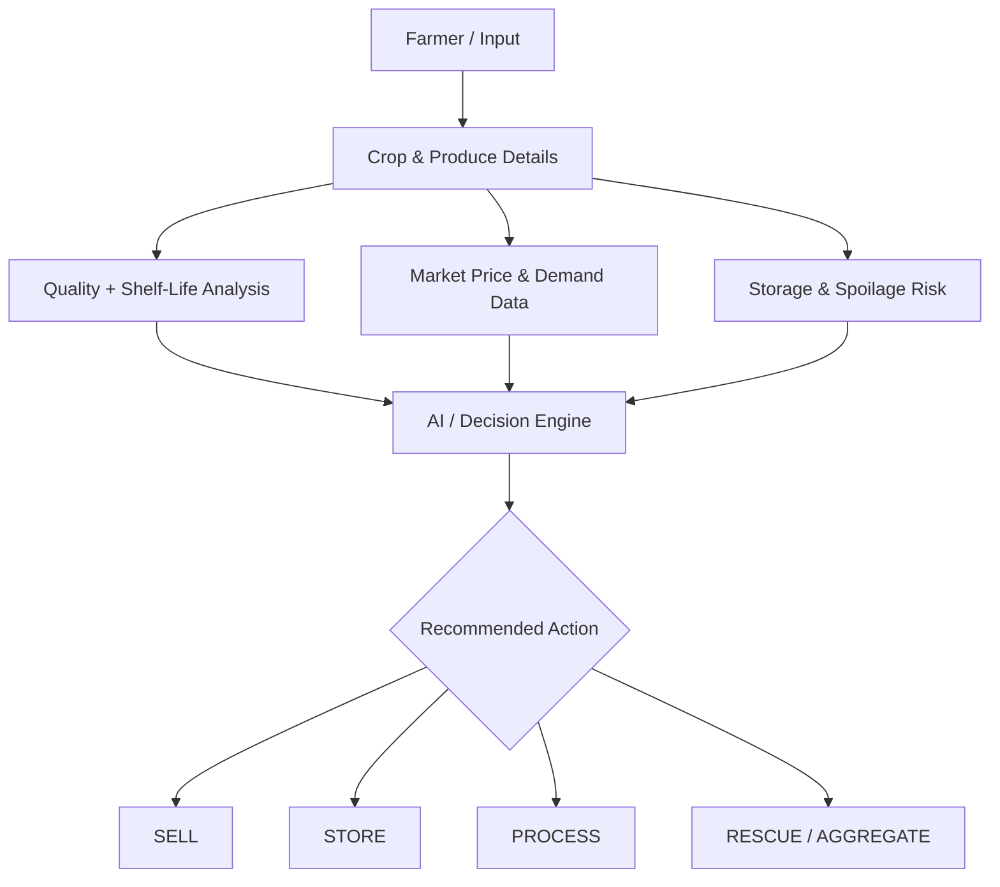
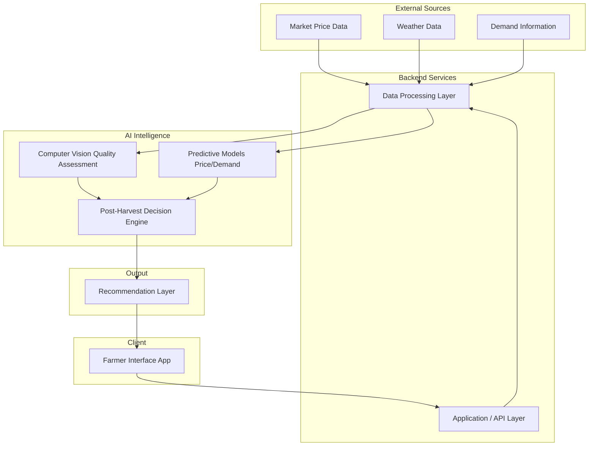

# KrishiSetu AI: Project Report
**Smart India Hackathon 2026**

**Team Name:** LogicForge  
**SIH Problem Statement ID:** SIH26193  
**Problem Statement:** Student Innovation – Developing solutions, keeping in mind the need to enhance the primary sector of India – Agriculture and to manage and process our agriculture produce.  
**Domain:** Agriculture / Primary Sector  
**Category:** Software  
**Project Name:** KrishiSetu AI  

---

## 1. EXECUTIVE SUMMARY

The Indian agricultural sector faces a massive challenge in post-harvest management, where a significant portion of produce is lost due to uninformed decisions, fragmented market information, and a lack of integrated supply chains. Currently, smallholder farmers struggle to determine the most profitable action to take with their harvest, often relying on guesswork or localized, limited information. 

**KrishiSetu AI** bridges this gap by acting as an integrated AI-powered post-harvest decision and value-optimization platform. Our solution leverages computer vision for quality assessment, predictive modeling for market prices, and dynamic risk evaluation to replace fragmented information with concrete, actionable recommendations. Instead of simply providing data, the AI Decision Engine evaluates the crop's condition, shelf-life, and market demand to recommend whether a farmer should **SELL, STORE, PROCESS, or AGGREGATE** their produce. This multi-factor approach aims to significantly reduce avoidable post-harvest losses, empower smallholder farmers with better bargaining power, and ultimately improve the net value realization of agricultural produce across India.

---

## 2. PROBLEM STATEMENT

From the farmer's perspective, successfully growing a crop is only half the battle. The post-harvest journey - **Harvest → Quality Assessment → Storage → Transportation → Mandi/Market → Buyer → Final Revenue** - is filled with critical uncertainties. 

Once produce is harvested, farmers face a difficult set of decisions with limited visibility into the outcomes. They must decide:
* **Whether to sell immediately:** Are current mandi prices favorable, or is the market oversupplied?
* **Whether to store the produce:** Will the price increase enough to cover cold storage costs, and will the crop's shelf-life survive the storage duration?
* **Whether to send it for processing:** Is the quality (e.g., grade B or C tomatoes) better suited for purees or value-addition rather than fresh market sales?
* **What to do when spoilage or market risk increases:** How can imminent losses be mitigated?

Without concrete, integrated guidance, farmers are forced to make high-stakes decisions based on intuition, leading to lower profit margins and high spoilage rates.

---

## 3. WHAT HAPPENS CURRENTLY?

In the **existing scenario**, farmers make post-harvest decisions in a highly fragmented ecosystem. The current process is hampered by several limitations:

* **Lack of integrated decision support:** Farmers check prices in one place, assess quality themselves, and arrange logistics separately. There is no unified system to analyze these factors together.
* **Price uncertainty & Demand fluctuations:** Market dynamics shift rapidly, and farmers often only discover the actual selling price after transporting their produce to the market.
* **Quality variation & Shelf-life limitations:** Not all harvested produce is grade A. Lower-grade produce often goes unsold or rots because farmers lack connections to processors who could utilize it.
* **Storage constraints & Spoilage risk:** Without predicting shelf-life and balancing it against future price trends, farmers risk storing produce that will spoil, or conversely, selling too early when storage would have been profitable.
* **Fragmented information and tools:** Current tools address single variables (like weather or price) rather than providing a holistic recommendation.

In short, the existing ecosystem expects the farmer to act as a data analyst, synthesizing disparate points of information to make a critical financial decision.

---

## 4. EXISTING SOLUTIONS & GAP

While various AgTech solutions exist, they typically address individual aspects of the agricultural pipeline rather than functioning as an integrated post-harvest decision engine.

| Existing Solutions | Limitation | Our Approach (KrishiSetu AI) |
| :--- | :--- | :--- |
| **Price prediction** | Predicts price but does not decide the next action. | Prediction + actionable decision. |
| **Crop advisory** | Mainly focused before/during production. | Strong post-harvest focus. |
| **Disease detection** | Focuses on crop health. | Considers post-harvest condition & quality. |
| **Market information** | Information is fragmented and siloed. | Integrated decision engine. |
| **Storage advice** | Limited consideration of market conditions. | Quality + shelf-life + price + demand together. |

**The Gap:** No existing system successfully combines quality assessment, predictive market pricing, logistics costs, and shelf-life into a single, unified recommendation engine. KrishiSetu AI fills this void by transitioning from mere data provision to actionable intelligence.

---

## 5. OUR PROPOSED SOLUTION

**KrishiSetu AI** is an **AI-Based Post-Harvest Decision & Rescue Engine**. 

Our system analyzes a comprehensive set of variables about the harvested produce:
**Crop + Quality + Quantity + Age/Shelf-life + Storage Conditions + Market Price + Demand + Spoilage Risk**

By processing these variables, the AI decision engine evaluates all possible pathways and recommends the most profitable and secure action for the farmer:

### SELL
Sell the produce immediately directly to the market when current prices, demand conditions, and logistics costs are favorable.

### STORE
Recommend cold storage when the future expected value justifies the storage costs, and the crop's evaluated shelf-life and spoilage risks are manageable.

### PROCESS
Redirect produce toward processing (e.g., purees, compost, value-addition) when the crop grade is lower or when processing provides a more profitable option than direct fresh-market sale.

### AGGREGATE / RESCUE
Identify high-risk produce or small quantities and recommend bulk pooling (aggregation) to gain bargaining power, or provide an alternative "rescue" pathway to prevent significant loss before it occurs.

**Our system does not only predict market conditions. It converts multiple factors into an actionable post-harvest decision.**

---

## 6. BEFORE VS OUR APPROACH

### BEFORE
The traditional approach places the burden of analysis entirely on the farmer.
**Farmer → Separate Information Sources → Manual Decision → Possible Delay/Loss**

### OUR APPROACH
KrishiSetu AI creates a streamlined, intelligent pathway.
**Farmer → Data Collection → AI Analysis → Decision Engine → SELL / STORE / PROCESS / RESCUE → Better Action**

By automating the synthesis of complex data, KrishiSetu AI empowers farmers to execute the optimal action quickly, minimizing waste and maximizing revenue.

---

## 7. COMPLETE SYSTEM WORKFLOW

* **Farmer / Input:** The farmer inputs basic details (crop, quantity, location) and uploads images of the produce.
* **Data Gathering & Analysis:** The system uses Computer Vision for quality assessment, while parallelly fetching real-time market data, price forecasts, and storage risks.
* **AI Decision Engine:** The core algorithm calculates the net potential value of each possible pathway.
* **Recommended Action:** The platform outputs the highest-value, lowest-risk action and connects the farmer to the appropriate buyer or facility.

---

## 8. USP / NOVELTY

**“We don't just predict what may happen to the crop  -  we recommend what the farmer should do next.”**

Our Unique Selling Propositions include:
* **Integrated post-harvest intelligence:** Moving beyond siloed information apps.
* **Multi-factor decision-making:** Simultaneously evaluating quality, shelf-life, market dynamics, demand, and risk.
* **Action-oriented recommendations:** Providing clear "Sell, Store, Process, or Rescue" directives.
* **Focus on reducing post-harvest losses:** Specifically targeting the gap between harvest and sale.
* **Alternative "rescue" pathways:** Establishing processor linkages for high-risk or lower-grade produce that would otherwise spoil.

---

## 9. TECHNICAL APPROACH

### Frontend
A lightweight, farmer-facing mobile application built in **Flutter** (or React Native) designed for low-bandwidth environments, supporting image uploads and displaying clear, actionable dashboards.

### Backend
A robust API layer built with **Python / FastAPI** to handle business logic, authentication, user sessions, and orchestration of the various AI models and database queries.

### Database
**PostgreSQL** extended with **PostGIS** for spatial data and routing. It stores:
* Crop and Farmer information
* Produce batches and image references
* Market data and historical price records
* Quality assessments and generated recommendations

### AI/ML Layer
The intelligence layer comprises distinct proposed models:
* **Quality/Vision:** OpenCV and YOLO for preliminary grading based on uploaded images.
* **Price/Demand Prediction:** Advanced deep learning models (like NBEATSX or LightGBM/XGBoost) integrating exogenous variables (weather, historical trends).
* **Shelf-life/Risk Estimation:** Probabilistic models evaluating the decay rate based on crop type, quality grade, and local weather.
* **Decision Scoring:** A custom optimization algorithm that calculates Net Value = Expected Revenue - (Logistics + Storage + Processing Costs) - Risk Penalty.

---

## 10. AI DECISION ENGINE

The AI Decision Engine evaluates multiple pathways by calculating the **Expected Selling Value** for each option. 

For a specific batch of produce, the engine computes:
* **Storage Cost** vs. **Expected Price Change**
* **Shelf-Life** vs. **Spoilage Risk**
* Current **Market Demand**
* Feasibility of a **Processing Opportunity** (Net-value calculation: Price - Logistics - Processing)

By aggregating these parameters, the Decision Engine scores the actions. The recommendation output is data-driven, interpretable, and prioritizes maximizing net value while mitigating the risk of total crop loss.

---

## 11. SYSTEM ARCHITECTURE

---

## 12. DATA REQUIREMENTS

To function effectively, KrishiSetu AI requires the following data points:
* **Farmer Input:** Crop type, quantity, harvest date, location.
* **Produce Context:** Quality/grade (inferred via CV), expected shelf-life.
* **Market Dynamics:** Current market price, historical price trends, regional demand.
* **Logistics & Infrastructure:** Storage conditions, cold-storage availability, transportation costs, processor/buyer availability.

*Note: Data availability and API integration will depend on access to existing agricultural datasets (e.g., e-NAM APIs, weather APIs).*

---

## 13. PROTOTYPE / IMPLEMENTATION

### MVP / Planned
* **Crop Focus:** The MVP will be built around **Tomatoes** as the primary use-case due to their high perishability and price volatility.
* **Farmer Interface:** Mobile application prototype allowing image upload and basic data entry.
* **Recommendation Output:** Basic implementation of the SELL / STORE / PROCESS logic based on static or simplified dynamic data.
* **Processor Matching Algorithm:** Planned integration to connect lower-grade produce directly to processing plants.
* **Deep Learning Integration:** Implementation of exogenous variable-driven models for price forecasting.

*(Note: Features are currently in the proposed design phase and will be implemented during the development lifecycle.)*

---

## 14. USER JOURNEY

1. **Enter Produce Details:** Farmer logs into KrishiSetu AI, enters crop, quantity, and location.
2. **Upload Image:** Farmer uploads a photo of the freshly harvested produce.
3. **System Analyses Data:** AI performs a preliminary quality assessment while the backend fetches market and weather data.
4. **Risk & Market Evaluation:** The Decision Engine compares the net values of Selling, Storing, Processing, or Aggregating.
5. **AI Recommendation:** The platform presents the best option (e.g., "STORE: Prices expected to rise by 12% in 5 days. Nearby cold storage available.").
6. **Farmer Selects/Acts:** The farmer accepts the recommendation and is connected directly with the relevant buyer, cold storage facility, or processor.
7. **Produce Reaches Best Destination:** Maximum value is realized, and waste is averted.

---

## 15. IMPACT

### For Farmers
* Better, data-driven post-harvest decisions.
* Reduced avoidable losses from spoilage and poor market timing.
* Improved net value realization and better utilization of produce.

### For Buyers/Processors
* Better visibility of available produce in the region.
* Improved sourcing of specific quality grades (e.g., purees manufacturers finding grade B/C tomatoes easily).

### For the Agricultural Ecosystem
* Reduced overall food wastage.
* Better resource utilization and optimized logistics.
* Improved, streamlined movement of produce toward suitable destinations.

---

## 16. FEASIBILITY

* **Technical Feasibility:** Highly feasible. The required technologies (Flutter, FastAPI, OpenCV, PyTorch) are mature and widely supported.
* **Data Availability:** Historical market price data and weather data are publicly accessible via government portals (like Agmarknet) and global weather APIs.
* **MVP Feasibility:** Focusing on a single, highly volatile crop (Tomato) allows for rapid testing, validation, and iteration of the Decision Engine.
* **Deployment:** Cloud deployment ensures high availability, and the mobile-first approach targets the primary device used by Indian farmers.

---

## 17. SCALABILITY

KrishiSetu AI is designed to scale across multiple dimensions:
* **Crop Expansion:** Extending the models from Tomatoes (TOP crops) to other perishables and eventually grains.
* **Geographical Expansion:** District → State → National scale rollout.
* **Linguistic Scaling:** Adding multi-language support to cater to diverse regional farming communities.
* **Ecosystem Growth:** Onboarding more buyers, cold storage providers, logistics partners, and processors into the platform.

---

## 18. FUTURE SCOPE

* **Multilingual & Voice-Based Interaction:** Allowing farmers to interact with the app using regional voice commands.
* **IoT-Based Storage Monitoring:** Integrating sensors from cold storage facilities to update shelf-life predictions in real-time.
* **Real-time Market Integration:** Direct bidding and matching with buyers/processors within the app.
* **Advanced Demand Forecasting:** Granular, region-specific micro-market predictions.
* **Improved Explainable AI:** Providing the farmer with simplified, visual explanations of *why* a certain recommendation was made.

---

## 19. CHALLENGES & MITIGATION

| Challenge | Mitigation Strategy |
| :--- | :--- |
| **Data Quality & Availability** | Use robust data cleaning pipelines; build fallback heuristics if real-time APIs fail. |
| **Market Volatility** | Utilize advanced exogenous deep learning models to capture sudden shifts; provide confidence intervals alongside recommendations. |
| **Farmer Adoption** | Keep the UI extremely simple; incorporate regional languages and voice inputs; pilot with FPOs for group adoption. |
| **Connectivity Limitations** | Design the app to function well on low-bandwidth networks, allowing asynchronous data uploading. |
| **Prediction Uncertainty** | Always include a "Rescue" pathway to minimize downside risk if primary recommendations fail. |

---

## 20. RESEARCH & EVIDENCE

The underlying approach to KrishiSetu AI's market prediction capabilities is strongly supported by recent scientific literature. Traditional statistical models often fail to capture the volatile nature of agricultural markets due to their inability to process complex, non-linear external factors.

According to a recent study published in ***Scientific Reports* (10.1038/s41598-024-68040-3)**, advanced deep learning models specifically designed for agricultural forecasting - such as **NBEATSX** and **TransformerX** - show significantly improved performance over conventional methods. The study highlights that integrating **exogenous variables** (such as precipitation and temperature data) directly into these deep learning architectures yields superior predictive accuracy for "TOP" crops (Tomato, Onion, and Potato) in India. 

> *“Deep learning models augmented with exogenous variables achieve superior predictive accuracy compared to conventional approaches [ARIMAX, MLR] and other machine learning algorithms [ANN, SVR, RFR, XGBoost].”* (Nayak et al., 2024).

KrishiSetu AI integrates these principles into its AI/ML Layer, ensuring that the Post-Harvest Decision Engine is powered by state-of-the-art, scientifically validated forecasting methodologies.

**Reference:**
Nayak, G.H.H., Alam, M.W., Singh, K.N. et al. Exogenous variable driven deep learning models for improved price forecasting of TOP crops in India. *Sci Rep* **14**, 17203 (2024). https://doi.org/10.1038/s41598-024-68040-3

---

## 21. CONCLUSION

The current agricultural ecosystem forces farmers to navigate a fragmented landscape of disconnected information, leading to high post-harvest losses and suboptimal revenue. **KrishiSetu AI** aims to fundamentally shift this paradigm by bringing critical post-harvest factors - quality, shelf-life, market price, demand, and risk - together under one unified platform. 

By analyzing these variables holistically, we provide smallholder farmers with concrete, actionable recommendations: whether to **SELL, STORE, PROCESS, or AGGREGATE**. 

**“From predicting the market to deciding the next best action.”** KrishiSetu AI isn't just an information portal; it is an intelligent engine designed to reduce avoidable losses, improve value realization, and secure a more profitable future for Indian agriculture.
