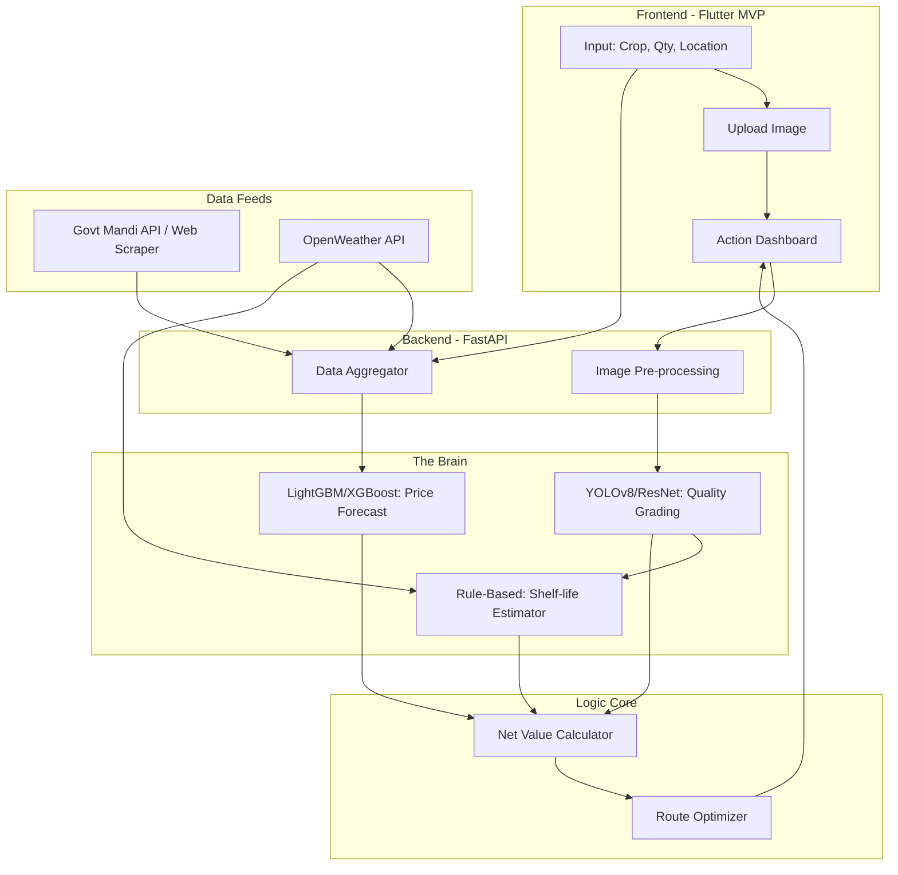

# KrishiSetu: SIH Expert Evaluation & Strategy Report
**Smart India Hackathon 2026**

As an SIH mentor and evaluator, I have critically reviewed your proposed solution, KrishiSetu. Below is a comprehensive, honest evaluation and an actionable roadmap to elevate this from a good idea to a winning, prototype-ready solution.

---

## A. Biggest Weaknesses in the Current Idea
1. **The "Everything App" Risk:** Trying to solve pricing, quality, routing, and demand all at once might lead to a shallow prototype. Evaluators will question if a student team can realistically build and train models for all these aspects within the hackathon timeline.
2. **Missing Implementation Details for "RESCUE":** The concept of rescuing near-spoilage produce is excellent, but how does the system actually execute it? If it just tells the farmer "Rescue this," it's not a solution. It must connect them to a *specific* fallback buyer or composting unit.
3. **Data Dependency:** The AI decision engine relies heavily on real-time market data, localized storage costs, and exact shelf-life modeling. If this data isn't available via APIs, the AI cannot function. 

## B. Biggest Strengths
1. **Action-Oriented Output:** The transition from "Here is the price" to "Here is what you should do" is a massive conceptual leap that solves the actual cognitive burden on the farmer.
2. **Multi-Factor Integration:** Acknowledging that price alone isn't enough to make a decision (e.g., high price but short shelf-life and no cold storage = bad outcome) is highly mature.
3. **Alignment with Primary Sector Needs:** Directly addresses the MoFPI and ICAR goals of reducing post-harvest losses and improving supply chain efficiency.

## C. Existing Solutions and Genuine Gaps

| Existing Solution Type | Example / Context | What it does | What it does NOT solve | The KrishiSetu Gap |
| :--- | :--- | :--- | :--- | :--- |
| **Market Price Portals** | Agmarknet, e-NAM | Shows current mandi prices and arrivals. | Doesn't tell the farmer if their specific crop quality will fetch that price, or if it will survive the transport. | **Synthesizes price with individual batch quality.** |
| **Agritech Advisory** | DeHaat, Kisan Suvidha | Provides weather info, crop advisory, and inputs. | Focuses heavily on pre-harvest and inputs. Post-harvest is usually just a marketplace. | **Focuses exclusively on optimizing the post-harvest decision window.** |
| **Price Forecasting ML** | Academic Research (e.g., NBEATSX for TOP crops) | Predicts future prices using weather and historical data. | A price prediction is a data point, not a decision. It ignores the farmer's local logistical constraints. | **Converts the prediction into a localized, logistical recommendation.** |

## D. Strongest Novelty Statement
**KrishiSetu introduces a "Post-Harvest Digital Twin" and an Action-Oriented Decision Engine.** 
Unlike traditional platforms that provide siloed data (price, weather, or buyers) and leave the analysis to the farmer, KrishiSetu creates a dynamic digital profile for a harvested batch. It continuously calculates the Net Expected Value across four pathways - SELL, STORE, PROCESS, RESCUE - and actively routes the produce to the destination that maximizes farmer revenue while minimizing physical waste.

## E. Improved Solution Architecture

## F. AI Decision-Engine Logic (Realistic MVP)

Instead of a massive, unexplainable black-box neural network, use a **Hybrid Rule + ML Scoring System**.

1. **INPUTS:**
   * `Crop_Type` (e.g., Tomato)
   * `Grade` (A, B, C - from Computer Vision model)
   * `Current_Price` (API)
   * `Forecast_Price_7_Days` (ML Model)
   * `Storage_Cost_Per_Day` (Static DB)
   * `Distance_To_Mandi` & `Distance_To_Processor` (API)

2. **PROCESSING (The Logic):**
   * **Shelf-Life `S`:** If `Grade == C`, `S = 2 days`. If `Grade == A`, `S = 7 days`.
   * **Sell Value:** `(Current_Price * Qty) - Transport_Cost`
   * **Store Value:** `(Forecast_Price_7_Days * Qty) - Transport_Cost - (Storage_Cost_Per_Day * 7)`. *Condition: `S` must be > 7 days.*
   * **Process Value:** `(Processor_Contract_Price * Qty) - Transport_Cost`.
   * **Rescue Value:** If `S < 2 days`, trigger local bulk compost/feed buyer at 20% value to avoid total loss.

3. **OUTPUT:**
   The engine selects the action with the highest Net Value and `Confidence > threshold`. It outputs an explainable string: *"Recommendation: STORE. Price expected to rise 15% next week, and your Grade A tomatoes will survive the storage period."*

## G. Prototype Screen-by-Screen Plan

To prove this works to judges, you only need **4 core screens**:

1. **Dashboard / Harvest Entry:**
   * **UI:** Simple form. "What did you harvest today?" 
   * **Inputs:** Dropdown for Crop (Tomato), text field for Quantity (KG). Button: "Assess Quality via Camera."
2. **Quality Assessment Results:**
   * **UI:** Shows uploaded image with bounding boxes or a simple grade (e.g., "Grade B - 75% Confidence").
   * **Output:** Estimated shelf-life indicator (e.g., "3-4 days remaining").
3. **The Engine at Work (Loading/Analysis Screen):**
   * **UI:** A visual checklist showing data being fetched. "Fetching Mandi Prices... Checking Weather... Analyzing Logistics..." (This builds trust).
4. **Recommendation & Action Card (The "Wow" Screen):**
   * **UI:** Big, clear recommendation: **"PROCESS"**.
   * **Explainable AI block:** *"Why? Your tomatoes are Grade B with 3 days shelf-life. Current mandi price is low (₹8/kg). A local puree processor is buying at ₹10/kg."*
   * **Action Button:** "Connect to Processor."

## H. Demo Scenario (2 Minutes)

* **Context:** A farmer just harvested 500kg of tomatoes. It rained heavily last week, affecting the crop.
* **Action 1 (0:00-0:30):** The presenter (acting as farmer) opens the app, enters 500kg, and uploads a photo of slightly bruised tomatoes.
* **Action 2 (0:30-1:00):** The app's vision model instantly grades them as "Grade C". Shelf-life is estimated at 2 days. 
* **Action 3 (1:00-1:30):** The app shows the baseline: If sent to Mandi, the price will be ₹4/kg, minus ₹2/kg transport = ₹1,000 profit. Spoilage risk is HIGH.
* **Action 4 (1:30-2:00):** The AI Engine overrides the "SELL" action and flashes **"RESCUE / PROCESS"**. It calculates that a nearby ketchup factory guarantees ₹6/kg. Net profit = ₹2,500. Waste avoided = 500kg.
* **Climax:** The presenter clicks "Accept" and the system generates a digital slip for the processor. The judges clearly see the financial and environmental impact.

## I. Technical Stack (SIH Friendly & Defensible)

* **Frontend:** Flutter (Single codebase for Android/iOS, easy to build clean UI).
* **Backend:** FastAPI (Python). Fast, lightweight, perfect for serving ML models.
* **Vision Model:** YOLOv8 or a fine-tuned MobileNet. (Do not train from scratch; fine-tune a pre-trained model on a Kaggle tomato quality dataset).
* **Forecasting Model:** XGBoost or LightGBM. (Easier to train and explain than deep neural networks; runs fast on limited hardware).
* **Database:** Supabase or Firebase (Easy to set up, real-time sync for the demo).

## J. Data Strategy

| Requirement | Proposed Source | Realistic Fallback for MVP |
| :--- | :--- | :--- |
| **Market Prices** | `data.gov.in` (Agmarknet APIs) | Download a CSV of historical prices, load into DB, and simulate an API. |
| **Crop Images (Training)** | Kaggle (e.g., "Tomato Disease/Quality dataset") | Hardcode 3 specific images (Good, Average, Bad) for the live demo to ensure it doesn't fail. |
| **Weather** | OpenWeatherMap API (Free tier) | Hardcoded JSON response. |
| **Processor Data** | Real processor locations | Mock database of 5 local buyers/processors. |

> [!CAUTION]
> **Judge Trap:** Judges will ask if you have real-time Agmarknet API access. **Answer truthfully:** "We are currently using a simulated endpoint based on historical Agmarknet CSV dumps to prove the logic. Upon government integration, we will swap the endpoint to the live API."

## K. Impact Metrics

* **Metric 1: Post-Harvest Loss Reduction.** 
  * *Baseline:* Current losses for perishables (like tomatoes) are 11-15% (Source: NABCONS 2022 Report). 
  * *Target:* Reduce avoidable farm-gate spoilage by 40% for platform users through the RESCUE/PROCESS pathways.
* **Metric 2: Decision Speed.** 
  * *Baseline:* Manual market research takes hours/days and physical visits. 
  * *Target:* Provide an actionable, data-backed recommendation in under 10 seconds.

## L. SIH Evaluator Questions + Answers

**Q: Why does this need AI? Can't a simple app just show the price?**
*A: Showing the price doesn't solve the problem if the farmer's crop will rot before reaching the market. We use AI (Computer Vision) to objectively grade the crop and predict its shelf-life. We use ML to forecast if the price will cover storage costs. AI is required to synthesize these complex, shifting variables into one clear decision.*

**Q: What happens if market data is wrong?**
*A: Our Decision Engine calculates a 'Confidence Score'. If market data volatility is too high or missing, the system defaults to the lowest-risk logistical option (like immediate local sale or processing) rather than risky long-term storage.*

**Q: How will you handle poor-quality input (bad photos from farmers)?**
*A: The app UI will have a bounding box guide. If the image is blurry, the CV model will return a "Low Confidence" flag and ask the farmer to retake the photo, rather than making a bad recommendation.*

**Q: What have you actually implemented vs what is planned?**
*A: For this prototype, we have implemented the Computer Vision grading model, the backend Decision logic engine, and the UI. Real-time API integration with e-NAM and onboarding real processing factories is planned for the post-hackathon pilot phase.*

## M. 6-Slide PPT Structure

1. **Title Slide:** "KrishiSetu: The AI Post-Harvest Decision Engine" + Team Info + Problem ID.
2. **The Problem:** "Harvested... Now What?" Show the confusion. Cite the NABCONS 2022 stat: 15% of fruits/vegetables lost post-harvest.
3. **The Gap in Existing Solutions:** Table showing how current apps only provide *information* (price, weather), while KrishiSetu provides *action*.
4. **Our Solution (The Logic):** A highly visual slide showing the "Digital Twin" equation: `Quality + Shelf-life + Forecast + Logistics = SELL/STORE/PROCESS/RESCUE`.
5. **Technical Architecture:** The Mermaid flowchart showing Flutter → FastAPI → YOLOv8/XGBoost → Recommendation.
6. **Impact & Feasibility:** The 4 prototype screens + the measurable impact targets + Scalability plan.

## N. Top 5 Changes Required Before Screening
1. **Drop generic ML terms.** Stop saying "AI-powered platform." Say: "Computer-vision quality grading coupled with an XGBoost pricing-logistics engine."
2. **Narrow the MVP scope.** Explicitly state in your submission: "MVP is constrained to Tomatoes in [Specific State/Region] to prove the algorithm's accuracy."
3. **Build the "Why" UI.** Ensure your prototype wireframes clearly show the "Explainable AI" section. Judges hate black boxes.
4. **Define the RESCUE pathway clearly.** Explain that RESCUE means integrating local composting, bio-gas, or animal feed buyers for grade D produce, ensuring zero-waste and recovering baseline transport costs.
5. **Use real Govt statistics.** Explicitly cite the "NABCONS 2022 study by MoFPI" or "ICAR-CIPHET 2015 study" on your problem slide.

## O. Final 30-Second Pitch
"Indian farmers lose up to 15% of perishable crops post-harvest because they lack integrated decision support. Existing apps just show mandi prices, leaving the farmer to guess if their crop's quality will survive the journey or if storage is profitable. KrishiSetu is an AI decision engine that analyzes a crop's quality via computer vision, forecasts prices, and calculates logistics to recommend the single most profitable action: Sell, Store, Process, or Rescue. We don't just predict the market; we direct the harvest."

## P. Final 2-Minute Pitch (Expansion for Demo)
*(Start with the 30-second pitch, then add:)*
"Let me show you how it works. A farmer harvests a batch of tomatoes that suffered slight rain damage. Traditionally, they would ship it to the mandi, discover it's considered 'Grade C', and take a massive loss. 
With KrishiSetu, they snap a photo. Our YOLOv8 vision model identifies it as Grade C with a 2-day shelf life. Our backend simultaneously checks the forecasted mandi price and storage costs. The Decision Engine realizes that shipping to the mandi will result in a net loss due to transport costs and high spoilage risk. 
Instantly, the AI overrides the 'SELL' pathway and recommends 'PROCESS'. It connects the farmer to a local puree manufacturer willing to buy Grade C produce. The farmer avoids a total loss, the processor gets cheap raw material, and food waste is averted. KrishiSetu turns raw data into optimized agricultural action."

---

### Innovation Check & Score: 8.5 / 10
* **Problem Relevance (10/10):** Post-harvest loss is a top priority for the Indian government.
* **Innovation & Differentiation (9/10):** The shift from "Predictive" to "Prescriptive" action is excellent.
* **Technical Feasibility (7/10):** Building the recommendation engine logic is hard but doable. Relying heavily on real-time data integration is risky for a 36-hour hackathon (mitigated by using historical data for the MVP).
* **Impact (9/10):** Highly measurable economic and environmental benefits.

**Verdict:** With the refinements above - specifically focusing the MVP on one crop, building a clear hybrid decision logic, and preparing strong answers regarding data availability - this idea is highly competitive and ready for SIH screening.
